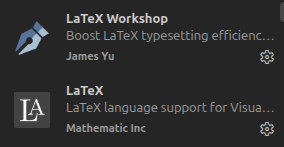

# Map Similarity Project (Wasserstein) and LaTeX Article

This repository contains two independent components:

1. A **ROS 2 workspace** (inside `src/`) for robot navigation, implementing the Wasserstein-based similarity metric for occupancy maps.
2. A **LaTeX article** (in the root directory) describing the research.

The LaTeX article can be compiled independently of the ROS 2 code.

## Project Structure

- `src/`: ROS 2 workspace containing packages for the navigation system.
- `Definitions/`: LaTeX style files and class definitions (`.cls`, `.sty`).
- `images/`: Figures for the article in vector formats (`.pdf`, `.eps`).
- `main.tex`: Main LaTeX document for the article.
- `sn-bibliography.bib`: Bibliography file for the article.

## Installation

The `install.sh` script installs the Python dependencies required by the ROS 2 packages (e.g., `numpy`, `scipy`, `POT`). Run it once after cloning:

```bash
bash install.sh
```
This will install the required Python packages via pip.

### Compiling the Article (LaTeX)

The article compiles independently of the content in src/.
- Option A: Using the Makefile (Recommended)
    ```bash
    make latex
    ```
    This generates main.pdf in the project root.

- Option B: Using VSCode (with LaTeX Workshop)
    1. Open the project in VSCode.
    2. Install the recommended extensions when prompted.

        

    3. Open main.tex and press Ctrl + Alt + B (or use the compile button in the LaTeX sidebar).

### Locate text in compiled PDF

SyncTeX allows you to locate the corresponding text in the compiled PDF from the source .tex file. 
- Press `Ctrl + clic` over text in pdf.

Forward search, also provided by SyncTeX. n VS Code with LaTeX Workshop:
- Place the cursor in the .tex source.
- Press `Ctrl + Alt + J`.
- The PDF opens and highlights the corresponding location 


### Building and Running the ROS 2 Workspace

The ROS 2 workspace is located in the src/ directory. To build it:
```bash
cd src
colcon build
```
This will execute colcon build inside src/. After building, source the setup file and launch your nodes as usual:
```bash
source src/install/setup.bash
ros2 run <your_package> <your_node>
```

### Cleaning Temporary Files
```bash
make clean
```

### Notes

The LaTeX environment variables (TEXINPUTS) are configured to point to the Definitions/ and images/ directories, so pdflatex will correctly find the class files and graphics without requiring manual placement.


---
